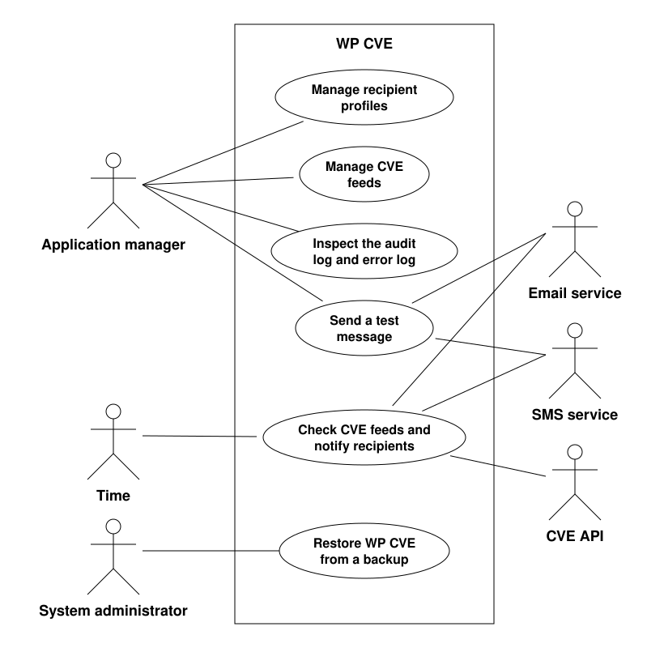

# WP CVE product scope

## Product boundary

## Product use cases

| Use case | Name | Actors | Requirements | Feature files |
|---|---|---|---|---|
| PUC-1 | Manage recipient profiles | Application manager | REQ-016, REQ-017, REQ-018, REQ-020, REQ-026, REQ-035, REQ-036, REQ-048, REQ-050, REQ-055, REQ-056, REQ-060, REQ-062 | [recipient_management.feature](features/recipient_management.feature) |
| PUC-2 | Manage CVE feeds | Application manager | REQ-004, REQ-005, REQ-006, REQ-007, REQ-008, REQ-024, REQ-025, REQ-039, REQ-040, REQ-051 | [cve_feeds.feature](features/cve_feeds.feature) |
| PUC-3 | Check CVE feeds and notify recipients | Time, CVE API, email service, SMS service | REQ-001, REQ-002, REQ-009, REQ-010, REQ-011, REQ-012, REQ-013, REQ-014, REQ-015, REQ-027, REQ-028, REQ-029, REQ-030, REQ-031, REQ-032, REQ-033, REQ-034, REQ-037, REQ-038, REQ-044, REQ-052, REQ-053, REQ-057, REQ-058, REQ-059, REQ-066, REQ-067 | [cve_notifications.feature](features/cve_notifications.feature), [delivery.feature](features/delivery.feature), [audit_log.feature](features/audit_log.feature), [cve_feeds.feature](features/cve_feeds.feature) |
| PUC-4 | Send a test message | Application manager, email service, SMS service | REQ-021, REQ-022, REQ-023, REQ-041, REQ-045, REQ-046, REQ-065 | [test_message.feature](features/test_message.feature) |
| PUC-5 | Inspect the audit log and error log | Application manager | REQ-003, REQ-042, REQ-043, REQ-054 | [audit_log.feature](features/audit_log.feature) |
| PUC-6 | Restore WP CVE from a backup | System administrator | REQ-047, REQ-061, REQ-063, REQ-064 | [backup.feature](features/backup.feature) |

### PUC-1 Manage recipient profiles

- **Trigger:** an application manager adds, edits or removes a recipient profile.
- **Actors:** application manager.
- **Precondition:** the user is logged in as an application manager.
- **Outcome:** the recipient profile is saved, updated or removed. A recipient profile holds the subscribed channels of one recipient, an email address only when subscribed to email, a phone number only when subscribed to SMS, and no CPE name; a recipient profile without a subscribed channel is rejected. The contact details are stored encrypted; unsubscribing from a channel removes the contact detail of that channel without a new confirmation of consent, and unsubscribing from the last channel is rejected. A recipient profile is saved, and its email address or phone number is changed, only when the application manager confirms the consent that the recipient gave by email to the helpdesk; the time of the confirmation and the confirming application manager are recorded. Removing a recipient profile removes its delivery records and error log entries. Removing the only recipient profile of a CVE feed suspends that CVE feed. Users who are not logged in as an application manager are denied these actions.

### PUC-2 Manage CVE feeds

- **Trigger:** an application manager creates a CVE feed, changes its CPE name or assigns a recipient profile to a CVE feed.
- **Actors:** application manager.
- **Precondition:** the user is logged in as an application manager.
- **Outcome:** the CVE feed is saved with one CPE name and either one or two recipient profiles. A CPE name that does not consist of 13 colon separated values, does not start with `cpe` and `2.3`, or of which the part, vendor, product or version component is `*`, is rejected, and the application manager is told why. A suspended CVE feed resumes when a recipient profile is assigned to it. Users who are not logged in as an application manager are denied these actions.

### PUC-3 Check CVE feeds and notify recipients

- **Trigger:** the scheduled time to poll the CVE feeds is reached, every two hours.
- **Actors:** time, CVE API, email service, SMS service.
- **Precondition:** at least one CVE feed is configured.
- **Outcome:** each CVE feed that is not suspended is polled. The first poll of a CVE feed, and the first poll after a change of its CPE name, report every CVE that matches its CPE name and has not been reported on that CVE feed; later polls request only the CVE modified since the last CVE received, using `lastModStartDate` and `lastModEndDate` in consecutive ranges of no more than 120 days. CVE modified while a CVE feed is suspended are recorded as reported without being sent, unless the next poll is a first poll after a change of its CPE name. The results of each request are retrieved in pages, using `startIndex` and `resultsPerPage`, until all results of that request have been retrieved. No more than 5 CVE API requests are sent within any period of less than 30 seconds, with at least 6 seconds between two requests. A failed request is retried every 6 seconds, up to 10 attempts in total, every failed attempt is recorded in the error log, and the next poll covers the period of an abandoned poll; after an abandoned first poll, the next poll is again a first poll. A vulnerability notification for each CVE that matches the CPE name of a CVE feed and has not been reported previously is sent to every recipient profile assigned to that CVE feed, through the channels to which the recipient profile is subscribed. A recipient profile assigned after the first poll of a CVE feed receives only CVE that the feed finds in later polls. Every delivery attempt is recorded in the audit log with a pending delivery status, which is updated from the delivery report of the email or SMS service. A failed delivery is recorded in the audit log and the error log, and is not retried; the CVE counts as reported. A CVE that matches no configured CVE feed is not sent to any recipient.

### PUC-4 Send a test message

- **Trigger:** an application manager sends a test message to a recipient profile.
- **Actors:** application manager, email service, SMS service.
- **Precondition:** the user is logged in as an application manager, and the recipient profile exists.
- **Outcome:** the test message is delivered through the same email and SMS services as a vulnerability notification. The test message lists the CVE feeds to which the recipient profile is assigned, and it is recorded in the audit log, marked as a test message. Its delivery status is updated from the delivery report, and a failed test message is recorded in the error log. Users who are not logged in as an application manager are denied this action.

### PUC-5 Inspect the audit log and error log

- **Trigger:** an application manager opens the audit log or the error log.
- **Actors:** application manager.
- **Precondition:** the user is logged in as an application manager.
- **Outcome:** the delivery status of past notifications, or the failed CVE API requests and failed deliveries, are presented to the application manager. Delivery records of removed recipient profiles are not shown. Users who are not logged in as an application manager are denied this action.

### PUC-6 Restore WP CVE from a backup

- **Trigger:** a system administrator restores WP CVE from a backup.
- **Actors:** system administrator.
- **Precondition:** the user is a system administrator, and a backup of WP CVE exists.
- **Outcome:** WP CVE is restored from the backup, and recipient profiles removed after the backup was made are not restored. Backups are encrypted and destroyed after 30 days, so the personal data of a removed recipient profile no longer exists in any backup after that period. Users who are not system administrators are denied a restore.
